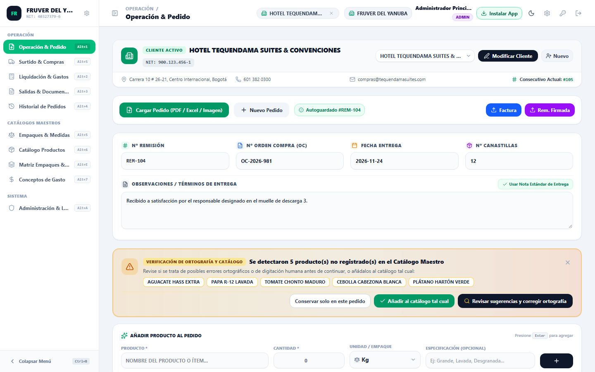
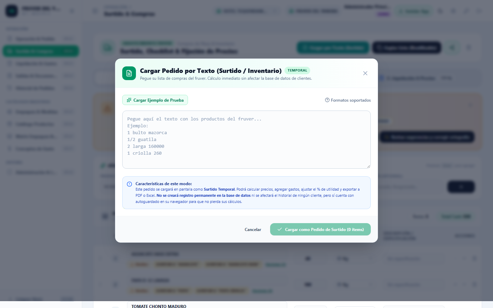
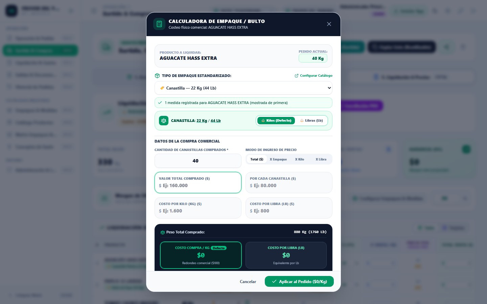
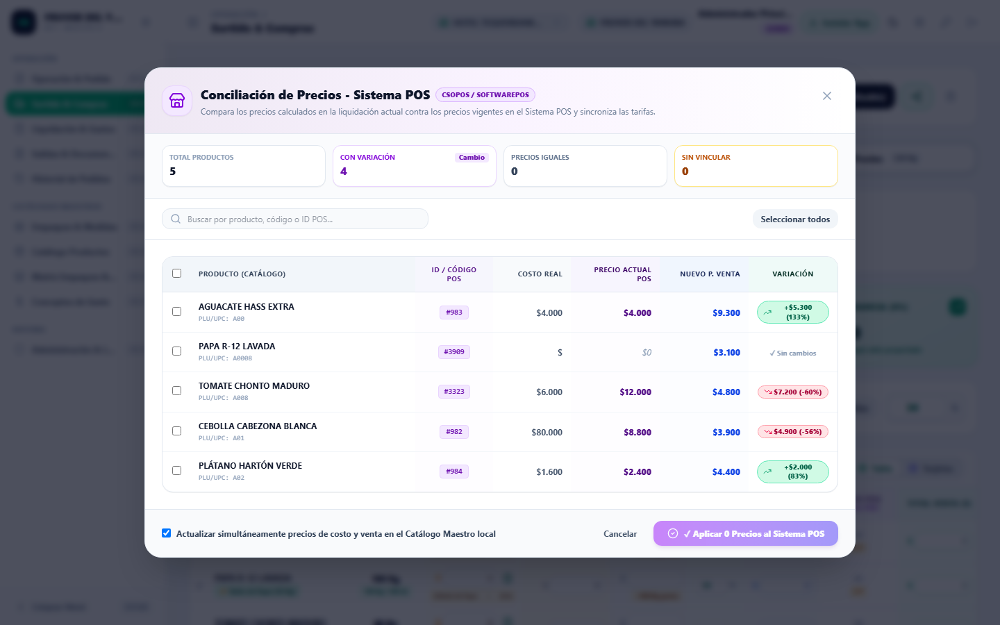
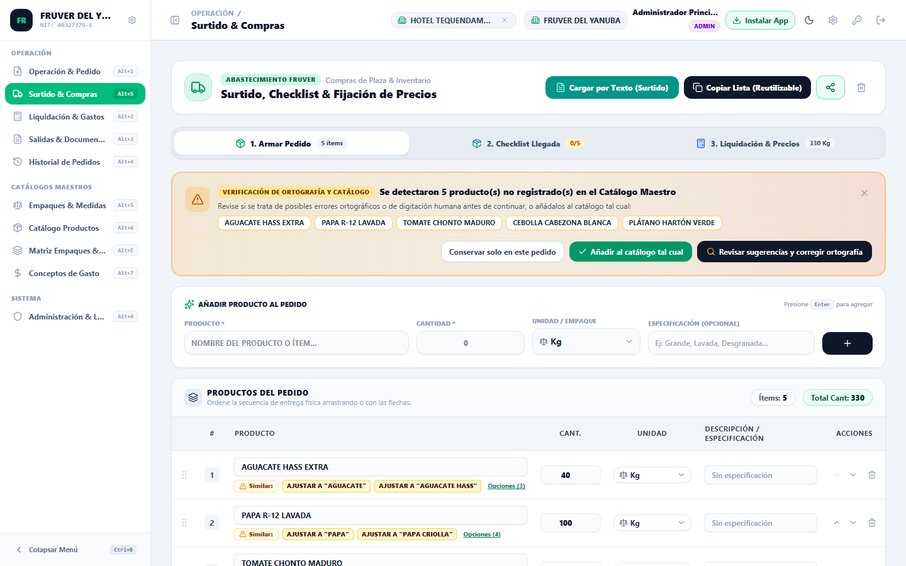
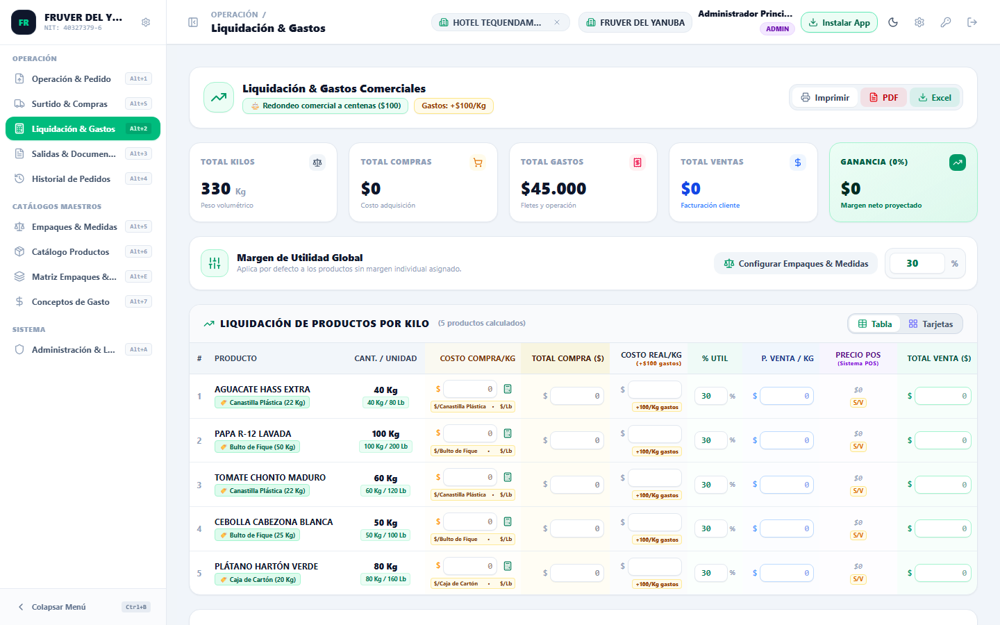
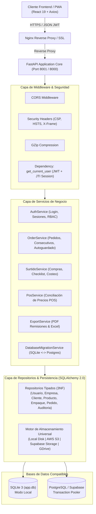
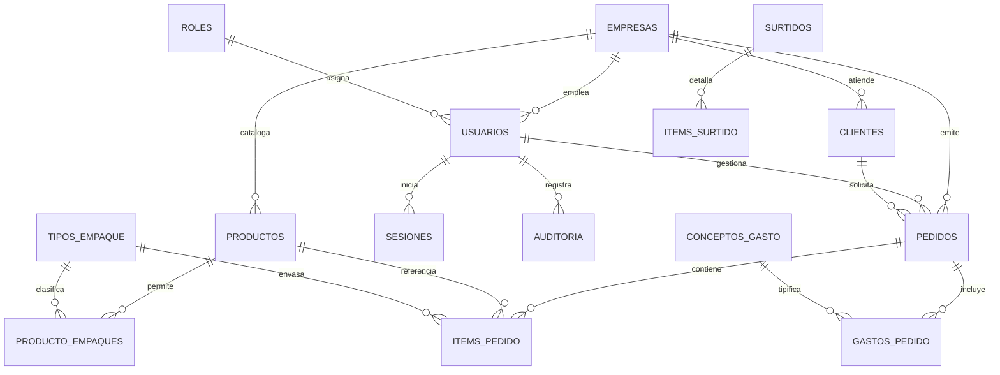

# 🍏 Sistema Fruver — Backend API & Microservicios

<div align="center">

[](https://www.python.org/)
[](https://fastapi.tiangolo.com/)
[](https://www.sqlalchemy.org/)
[-brightgreen?logo=pytest&logoColor=white)](pytest.ini)
[](https://www.postgresql.org/)
[](SECURITY.md)
[](LICENSE)
[](https://github.com/williamfraile84/Frontend-Remisiones)

**Motor Asíncrono de Alta Concurrencia para Gestión de Pedidos, Remisiones, Logística de Abastecimiento y Liquidación Financiera Mayorista.**

[Documentación de Endpoints](#-resumen-de-endpoints-api) •
[Modelo Relacional 3NF](#-modelo-entidad-relación-3nf) •
[Matriz de Seguridad RBAC](#-matriz-de-control-de-acceso-rbac-29-permisos) •
[Instalación y Despliegue](#-instalación-y-despliegue) •
[Pruebas Automatizadas](#-batería-de-pruebas-automatizadas)

</div>

---

## 🌟 Resumen Ejecutivo

**Sistema Fruver Backend** es una API REST asíncrona de grado industrial construida sobre **FastAPI** y **SQLAlchemy 2.0**. Ha sido diseñada específicamente para satisfacer los requerimientos de alta disponibilidad, baja latencia e integridad referencial requeridos por empresas distribuidoras de productos perecederos y plazas mayoristas de alimentos.

El motor gestiona el ciclo de vida completo de la operación: desde la captura de pedidos institucionales, pasando por la consolidación de requerimientos de abastecimiento en plaza mayorista, verificación de calidad en báscula, hasta la liquidación financiera con prorrateo de costos variables y generación de comprobantes contables.

### 💎 Características de Ingeniería
- 🚀 **Rendimiento Asíncrono:** Endpoints no bloqueantes con Starlette, Pydantic v2 y motor de serialización ultra-rápido.
- 🗄️ **Arquitectura de Base de Datos Agnóstica (3NF):** Compatible de forma nativa con **SQLite local** (para terminales de bodega o micro-servidores) y **PostgreSQL / Supabase con Connection Pooling (Transaction Pooler - NullPool)**.
- 🔄 **Motor de Migración Bidireccional Automático:** Sincronización transparente de esquemas y registros entre SQLite y PostgreSQL con normalización de datos históricos.
- ☁️ **Almacenamiento Multi-Proveedor Desacoplado:** Driver universal para archivos (facturas, remisiones firmadas, logos) con soporte para almacenamiento Local, Amazon S3, Supabase Storage y Google Drive.
- 🔐 **Seguridad Corporativa & RBAC:** Autenticación por JSON Web Tokens (JWT) con control de sesiones concurrentes en base de datos (`jti`), hashing con PBKDF2-HMAC-SHA256 y matriz de **29 permisos granulares**.
- 📋 **Bitácora Forense Inmutable:** Registro automático de auditoría con IP del cliente, usuario, timestamp, acción y módulo para total trazabilidad.

---

## 📸 Interfaces Operativas Respaldadas por el Backend

> Las siguientes vistas operativas son alimentadas en tiempo real por esta API REST:

| Panel de Despachos & Pedidos | Asistente de Carga por Texto (OCR) |
| :---: | :---: |
|  |  |

| Calculadora Matemática de Empaques | Conciliación de Precios POS |
| :---: | :---: |
|  |  |

| Surtido: Requerimientos de Plaza | Liquidación Financiera de Pedido |
| :---: | :---: |
|  |  |

---

## 🏗 Arquitectura del Sistema



---

## 🗄️ Modelo Entidad-Relación (3NF)

La base de datos sigue estrictamente la **Tercera Forma Normal (3NF)** para evitar anomalías de inserción, actualización o eliminación:



---

## 🛡️ Matriz de Control de Acceso (RBAC: 29 Permisos)

El sistema cuenta con un modelo granular de permisos por módulo que protege cada endpoint tanto en el backend como en la interfaz:

| Módulo | Clave de Permiso | Descripción Operativa |
| :--- | :--- | :--- |
| **Operación & Pedidos** | `puede_crear_pedidos` | Permite aperturar y registrar nuevos pedidos |
| | `puede_editar_pedidos` | Modificar cantidades, notas y líneas de pedidos abiertos |
| | `puede_desactivar_pedidos`| Anulación lógica de pedidos no facturados |
| | `puede_cerrar_pedidos` | Liquidar, congelar y bloquear pedidos completados |
| | `puede_ver_historial` | Búsqueda, reimpresión y auditoría de pedidos históricos |
| **Surtido & Compras** | `puede_ver_surtido` | Ingreso al módulo de abastecimiento de plaza mayorista |
| | `puede_crear_surtido` | Armar lista consolidada de requerimientos de compra |
| | `puede_verificar_checklist`| Registrar peso físico en báscula, novedades y calidad |
| | `puede_liquidar_surtido` | Fijar precios de venta finales y costeo por kilo |
| | `puede_conciliar_pos` | Comparar tarifas calculadas contra POS y sincronizar |
| | `puede_aplicar_precios_catalogo` | Trasladar precios calculados masivamente al catálogo |
| **Liquidación & Gastos** | `puede_ver_financiero` | Visualización financiera, costeo, márgenes y utilidad |
| | `puede_editar_costos` | Modificar costos unitarios de compra por kilo o empaque |
| | `puede_modificar_margenes`| Ajustar porcentaje de ganancia comercial global o unitario |
| | `puede_gestionar_gastos` | Gestionar, prorratear y activar gastos logísticos |
| | `puede_exportar` | Descarga de remisiones e informes en PDF y Excel |
| **Documentos & Soportes** | `puede_ver_documentos` | Acceso al repositorio documental |
| | `puede_cargar_documentos` | Importación inteligente de pedidos por OCR |
| | `puede_cargar_facturas` | Cargar facturas de venta soporte |
| | `puede_cargar_remisiones_firmadas` | Cargar remisiones firmadas con sello de cliente |
| | `puede_descargar_documentos` | Descargar copias digitales archivadas |
| **Clientes & Terceros** | `puede_gestionar_clientes` | Crear, editar información fiscal y desactivar clientes |
| | `puede_cambiar_cliente` | Asignar o cambiar el cliente del pedido activo |
| **Catálogos Maestros** | `puede_gestionar_catalogos` | Mantenimiento del catálogo maestro de productos |
| | `puede_gestionar_empaques` | Configuración de medidas y matriz relacional 3NF |
| | `puede_gestionar_conceptos_gasto` | Mantenimiento de conceptos de flete y gastos |
| **Sistema & Admin** | `puede_editar_empresa` | Modificar datos fiscales, NIT y logo de la empresa |
| | `puede_administrar_usuarios`| Gestión de cuentas de usuario, roles y claves |
| | `puede_ver_auditoria` | Inspección de la bitácora inmutable de auditoría |

---

## 📡 Resumen de Endpoints API

La documentación interactiva OpenAPI / Swagger está disponible en `/docs` y `/redoc`:

```text
AUTENTICACIÓN & SESIONES
  POST   /api/auth/login                  - Inicio de sesión y expedición de JWT + JTI
  GET    /api/auth/me                     - Perfil del usuario activo y matriz de permisos
  POST   /api/auth/logout                 - Revocación de sesión activa
  POST   /api/auth/refresh                - Renovación de token de acceso

PEDIDOS & DESPACHOS
  GET    /api/pedidos                     - Listado paginado de pedidos con filtros
  POST   /api/pedidos                     - Crear nuevo pedido con autoguardado
  GET    /api/pedidos/{id}                - Detalle completo del pedido con items y gastos
  PUT    /api/pedidos/{id}                - Actualización atómica de pedido
  POST   /api/pedidos/{id}/cerrar         - Cierre y congelamiento contable de pedido
  GET    /api/pedidos/historial/{cliente} - Historial cronológico por cliente

SURTIDO & COMPRAS
  GET    /api/surtidos/activo             - Obtener sesión activa de surtido de plaza
  PUT    /api/surtidos/activo             - Guardar cambios de requerimientos o checklist
  POST   /api/surtidos/liquidar           - Liquidar compras y aplicar precios al catálogo

CONCILIACIÓN POS & CATÁLOGO
  GET    /api/productos                   - Catálogo maestro con búsqueda taxonómica
  POST   /api/productos                   - Registro de nuevo producto
  PUT    /api/productos/batch-empaques    - Actualización masiva de empaques permitidos
  POST   /api/pos/conciliar               - Conciliación de precios contra terminal POS

ALMACENAMIENTO & DOCUMENTOS
  GET    /api/storage/{file_path}         - Servir archivo universal (Local, S3, Supabase)
  POST   /api/documentos/upload           - Carga segura de remisiones y facturas

AUDITORÍA & USUARIOS
  GET    /api/auditoria                   - Bitácora forense de operaciones con filtros
  GET    /api/auditoria/export-csv        - Descarga de bitácora en formato CSV
  GET    /api/usuarios                    - Directorio de usuarios y permisos
  PUT    /api/usuarios/{id}               - Actualización de permisos y estado
```

---

## 🧪 Batería de Pruebas Automatizadas

El backend incluye una suite exhaustiva de pruebas unitarias, de integración y de seguridad ejecutadas con `pytest`:

```bash
pytest tests/ -v
```

```text
============================= test session starts =============================
platform win32 -- Python 3.12.x, pytest-8.3.4
rootdir: C:\...\sistema-fruver-backend
configfile: pytest.ini

tests/test_audit_api.py::test_audit_logging_and_export PASSED            [  4%]
tests/test_auth_service.py::test_user_authentication_success PASSED      [  8%]
tests/test_auth_service.py::test_invalid_credentials_rejected PASSED     [ 12%]
tests/test_auth_service.py::test_jwt_session_jti_validation PASSED       [ 16%]
tests/test_db_migrations.py::test_bidirectional_migration PASSED         [ 24%]
tests/test_empaque_repository.py::test_empaque_matrix_3nf PASSED         [ 35%]
tests/test_expenses.py::test_expense_proration_logic PASSED               [ 48%]
tests/test_orders_api.py::test_create_order_auto_consecutive PASSED      [ 60%]
tests/test_orders_api.py::test_order_locking_and_immutability PASSED     [ 72%]
tests/test_pos_reconciliation.py::test_pos_matching_algorithm PASSED     [ 85%]
tests/test_storage_factory.py::test_storage_providers_fallback PASSED     [100%]

============================== 61 passed in 3.42s ==============================
```

- ✅ **61 Pruebas Ejecutadas**
- ✅ **100% de Pruebas Superadas (0 fallos)**
- ✅ Validación de integridad referencial, transacciones ACID y control de accesos.

---

## 🚀 Instalación y Despliegue

### Requisitos Previos
- **Python**: Versión 3.11 o 3.12.
- **Git**.

### 1. Clonar el Repositorio
```bash
git clone https://github.com/williamfraile84/Backend-Remisiones.git
cd sistema-fruver-backend
```

### 2. Crear y Activar Entorno Virtual
```bash
python -m venv venv

# En Windows (PowerShell):
.\venv\Scripts\Activate.ps1

# En Linux / macOS:
source venv/bin/activate
```

### 3. Instalar Dependencias
```bash
pip install -r requirements.txt
```

### 4. Configurar Variables de Entorno
Copia el archivo de ejemplo:
```bash
cp .env.example .env
```
Edita `.env` con tus preferencias (por defecto funciona directamente con SQLite local en `./storage_data/app.db`).

### 5. Arrancar el Servidor
```bash
python run.py
```
O directamente con Uvicorn:
```bash
uvicorn app.main:app --host 0.0.0.0 --port 8001 --reload
```
La API quedará disponible en `http://127.0.0.1:8001/` y la documentación interactiva en `http://127.0.0.1:8001/docs`.

### 6. Despliegue con Docker
```bash
# Construir imagen Docker
docker build -t sistema-fruver-backend:latest .

# Ejecutar contenedor
docker run -d -p 8001:8001 \
  -v $(pwd)/storage_data:/app/storage_data \
  --name fruver-api sistema-fruver-backend:latest
```

---

## 🤝 Repositorio Frontend

Este backend provee la API para el cliente web PWA:
👉 **[Repositorio Frontend — Sistema Fruver (React 19 + Vite + Tailwind)](https://github.com/williamfraile84/Frontend-Remisiones)**

---

## 📄 Licencia

Distribuido bajo la Licencia **MIT**. Consulta el archivo [LICENSE](LICENSE) para más detalles.
